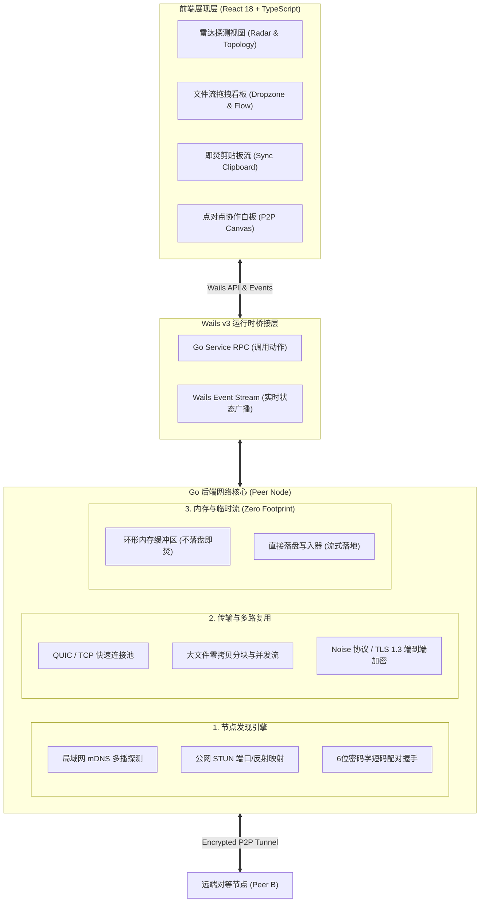

# GhostTunnel (幽灵隧道) — P2P 零中继极速瞬移空间
## 全景工程开发设计文档与技术规格书

> **项目定位**：基于 **Wails v3 (Go) + React 18 (TypeScript)** 构建的零云端、零审查、端到端加密、无限速点对点（P2P）局域网与公网协作工具。

---

## 目录
1. [系统整体架构与分层设计](#一系统整体架构与分层设计)
2. [P2P 网络与通信协议规范](#二p2p-网络与通信协议规范)
3. [Go 后端核心模块与服务设计](#三go-后端核心模块与服务设计)
4. [前端 UI/UX 设计语言与原型规格](#四前端-uiux-设计语言与原型规格)
5. [分阶段实施路线图 (Roadmap)](#五分阶段实施路线图-roadmap)
6. [技术难点攻关与踩坑预警](#六技术难点攻关与踩坑预警)

---

## 一、系统整体架构与分层设计

GhostTunnel 采用典型的**端对端对等网络模型**，每台启动应用的客户端既是发起方（Client）也是监听方（Server）。



---

## 二、P2P 网络与通信协议规范

### 1. 节点发现机制
- **局域网自发现（LAN Discovery）**：
  - 协议标准：DNS-SD / mDNS（基于标准多播 UDP 端口 `5353`，服务名 `_ghosttunnel._tcp`）；
  - 广播载荷：`{ "peer_id": "xxx", "device_name": "Chen's MacBook Pro", "port": 49152, "pub_key": "..." }`；
  - 周期：每 3 秒心跳广播一次，超过 9 秒未收到心跳标记为掉线。
- **公网穿透握手（WAN Tunnel）**：
  - 采用公用公开的免费 STUN 服务器（如 `stun.l.google.com:19302`）解析自身 NAT 类型与外网映射 `IP:Port`；
  - 双方通过极简短码（如 `falcon-7x`）配合自托管超轻量信标或公共 DHT 交换各自的反射地址，完成 UDP/TCP 打洞。

### 2. 二进制帧传输协议（Framing Protocol）
两台机器建立 TLS/Noise 连接后，底层统一通过轻量级二进制帧交互，杜绝臃肿的 HTTP Header 开销：

| 字节偏移 (Bytes) | 字段名称 | 类型 | 说明 |
| :--- | :--- | :--- | :--- |
| `0 ~ 3` (4B) | `MagicHeader` | `uint32` | 协议魔数：`0x47485354` ("GHST") |
| `4` (1B) | `MsgType` | `uint8` | `0x01`: 握手响应, `0x02`: 文本/剪贴板, `0x03`: 文件元数据, `0x04`: 文件数据块, `0x05`: 白板坐标, `0x09`: 心跳 |
| `5 ~ 12` (8B) | `StreamID` | `uint64` | 会话/文件流唯一自增标识 |
| `13 ~ 20` (8B) | `PayloadLen` | `uint64` | 载荷长度 $N$ |
| `21 ~ 21+N` | `Payload` | `[]byte` | 密文载荷数据 |

---

## 三、Go 后端核心模块与服务设计

Wails 应用的核心在于将 Go 的网络能力通过 Service 方式注册并向前端广播事件：

### 1. 核心 Service 接口设计

```go
package main

import (
	"context"
	"github.com/wailsapp/wails/v3/pkg/application"
)

// P2P 统一服务，注册进 application.New
type P2PService struct {
	ctx           context.Context
	node          *PeerNode
	discoveredMap sync.Map // 发现的对端列表
}

func (s *P2PService) ServiceStartup(ctx context.Context, options application.ServiceOptions) error {
	s.ctx = ctx
	// 1. 初始化本地 Peer 身份 (生成临时 Ed25519 密钥对)
	// 2. 启动本地监听端口 (随机可用高位端口)
	// 3. 启动 mDNS 后台探测 Goroutine
	return s.startBackgroundDiscovery()
}

// 暴露给 React 调用的 RPC 接口：
func (s *P2PService) ConnectPeer(peerID string) error
func (s *P2PService) SendClipboard(text string) error
func (s *P2PService) SendFiles(filePaths []string) error
func (s *P2PService) Disconnect() error
```

### 2. Wails 事件契约 (Go -> React)
- `p2p:peer:found`: 发现新对等节点，附带设备名、IP、信号强度；
- `p2p:peer:lost`: 节点离线；
- `p2p:tunnel:established`: 隧道成功建立，进入加密通信态；
- `p2p:transfer:progress`: 传输进度通知 `{ streamId, filename, totalBytes, sentBytes, speedBps }`；
- `p2p:clipboard:received`: 接收到对端加密同步的文本。

---

## 四、前端 UI/UX 设计语言与原型规格

### 1. 设计语言体系
- **风格定位**：**Cyber Minimalist Dark (赛博极简暗黑)**；
- **主色调**：
  - 背景底色：`#0A0B10`（深空极黑）；
  - 卡片磨砂玻璃：`rgba(20, 24, 38, 0.65)` + `backdrop-filter: blur(20px)`；
  - 核心霓虹强调色：`#00F2FE`（青色冷光，代表安全通信）与 `#4FACFE`（传输数据流）；
  - 警戒与警示色：`#FF0055`（断开/未授权连接）；
- **动效节奏**：
  - 雷达扫描圆环（CSS 360° 旋转脉冲光晕）；
  - 文件拖拽悬停触发高斯模糊流光边框；
  - 传输速率动态波形图（基于 Canvas / ECharts 轻量绘制）。

---

## 五、分阶段实施路线图 (Roadmap)


### 阶段 1：局域网雷达与极简握手 (1~2天)
- **目标**：两台电脑打开软件，能看到对方的名字出现在雷达上，点击可发起 TCP 握手。
- **核心包**：`github.com/grandcat/zeroconf` (Go 纯实现的 mDNS)。
- **产出**：完成节点探测与在线列表刷新。

### 阶段 2：实时剪贴板流与文本即焚 (1天)
- **目标**：A 电脑输入或复制一段文本，点击发送，B 电脑无延迟弹窗接收。
- **核心包**：Wails 原生系统通知 + Go TCP Socket 编解码。

### 阶段 3：大文件零拷贝分块直传 (2~3天)
- **目标**：拖入 5GB 视频文件，直接打通对端磁盘写入，支持实时显示传输速度（MB/s）与百分比。
- **技术要点**：使用 `io.Copy` 或 `bufio`，分块（每块 1MB~4MB）流式读取，避免全量读入内存撑爆 OOM。

### 阶段 4：Noise 协议端到端加密与公网穿透 (进阶)
- **目标**：不局限于同一个 WiFi，只要连网即可通过 6 位配对码完成打洞直连。

---

## 六、技术难点攻关与踩坑预警

1. **macOS 本地网络权限拦截**：
   - macOS 15+ 会弹窗提示“允许该应用查找本地网络上的设备”，首次开发调试时务必点击允许。
2. **大文件传输内存溢出（OOM）**：
   - 严禁一次性 `os.ReadFile` 整个大文件；必须采用固定大小的 `[]byte` 分块流式管道传递。
3. **NAT 穿透对称型受限**：
   - 少数企业级对称 NAT 无法通过普通 STUN 打洞，设计时需预留优雅失败提示与手动端口映射模式。
